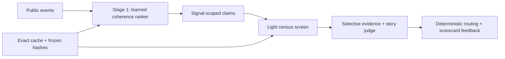

# Sentinel

An anomaly detection + triage agent for public event streams that **grades itself in public**.

> **A learned coherence ranker surfaces 88% of maintainer-confirmed incidents a
> median 13.4 hours before maintainers confirm them. Adding an LLM triage stage at
> repository-hour granularity does not work; signal-scoped v7 fixed the candidate
> unit, but its 4,412→4 election violated the pre-declared funnel shape. V7.1
> changes only that label-blind throttle and publishes the result beside v7.**

Sentinel is a two-stage system:

1. A recall-optimized learned ranker scores every active repository-hour from public
   activity, release proximity, participant structure, cross-thread coherence, and
   automation-aware features.
2. A precision study turns flagged hours into signal-scoped claims, screens the complete
   compact candidate set, fetches bounded heavy evidence only for elected claims, and
   groups sibling findings into stories. Every claim receives a disposition.

Everything around the judge is deterministic: source normalization, feature definitions,
the frozen threshold, batching, evidence selection, routing, hashes, exact-response cache,
and the append-only scorecard feedback loop. The judge is provider-agnostic. The published
v7/v7.1 studies used Claude Opus 4.8 through Claude subscription authentication; the offline hero
uses a committed GPT-5.6 exact-response fixture.



## The frozen arc

| Version | Intervention | Honest result |
|---|---|---|
| v1 | Naive burst thresholds | 20 firings; agent rejected all as mixed routine/automation and 18 stayed unresolved by later labels. |
| v2 | Phase-matched, noise-hardened rates | Zero firings and four published misses: killing noise killed signal. |
| v3 | First coherence model | Five training positives; underpowered and reported as unknowable. |
| v4 | Powered, whole-repository-held-out study | **ROC AUC 0.841, 88% incident recall, 13.4h median lead.** 64 / 287 incidents were outside burst windows entirely. |
| v5 | One giant LLM batch | Evidence-starved: 16.6% precision, 77.0% incident recall. |
| v6 | Rich evidence in scheduled-size batches | 19.6% precision, 56.4% incident recall. The repository-hour is the wrong triage unit. |
| v7 | Signal-scoped screen → categorical election | 50.0% story precision, **0.35% incident recall**. The 4 / 4,412 election violated the committed funnel spec before labels were consulted. |
| v7.1 | Exact v7 reuse → top-decile election | 24.2% story precision, **2.44% incident recall** (7 / 287). The corrected 4,412→442 policy restored the pre-declared shape; no other component changed. |

The v6 result is intentionally not marketed as a win. A repository-hour mixes unrelated
threads, routine automation, and real incidents; richer evidence made the judge more
confident about the bag, not more accurate about the issue inside it. V7 corrected the
unit, but its 1,103× election throttle failed the architecture's pre-declared rate shape;
that is a spec violation, not a finding against signal scoping. V7.1 freezes all v7 inputs,
prompts, models, schemas, evidence, and evaluation, changes only the label-blind election
to 9.98×, and catches seven of 287 labeled incidents. Every frozen identity is visible at
`/scorecard`.

## Install and test

```bash
uv sync --extra dev
uv run pytest -q
uv run sentinel --help
```

## Supported platforms

- Python 3.11 or newer on macOS or Linux. The release wheel is validated in a clean,
  isolated environment on macOS arm64; the included Dockerfile is the Linux deployment
  path. Native Windows has not been validated.
- `/replay` and `/scorecard` need neither a model key nor a network call. They run from
  committed source data and exact-response fixtures.
- `/live` needs network access for GH Archive. Claude triage is optional and requires a
  locally authenticated Claude Code subscription; without it, the page reports the
  deterministic candidates instead of inventing a verdict.
- The convenience scripts use POSIX shell. Every frozen study step they wrap also has a
  direct `uv run python ...` command documented below.

## Judge-facing web surfaces

```bash
uv run sentinel serve
```

Open `http://127.0.0.1:8000`. The server exposes:

- `/replay/webpack`: recomputes the webpack v5.99.0 stage-one firing from 245 committed
  source events, resolves the exact GPT-5.6 stage-two fixture with network calls disabled,
  and links every timeline timestamp to GitHub. The legacy incident URL redirects here.
- `/scorecard`: publishes the v1→v7.1 iteration trail, frozen identities, both v7 funnels,
  full- and clean-source cuts, automation accounting, and all 125 v6 labeled misses.
- `/live`: fetches one recent completed GH Archive hour only after a visible button press,
  persists exact coverage, and runs the frozen v4 learned ranker once its seven-day history
  is complete. If Claude subscription auth is available, all candidates are judged in one
  scheduled batch; otherwise the page degrades explicitly to candidates only.

The replay input is source data rather than a stored detector result or screenshot.
Regenerate it from the validated DuckDB cache with:

```bash
uv run python scripts/build_web_replay_fixture.py
```

The included `Dockerfile` is the hosted-deploy path for any container-capable ASGI
host. It needs no model key for `/replay` or `/scorecard`; `/live` makes a public
GH Archive download and uses Claude subscription auth only when candidates exist.
Build and test the production image locally:

```bash
docker build -t sentinel .
docker run --rm -p 8000:8000 sentinel
```

Deploy the same no-key judge path to a free Render Web Service:

[](https://render.com/deploy?repo=https://github.com/rpinho/sentinel)

The committed `render.yaml` selects the free Docker plan, binds the server to Render's
`PORT`, and checks `/replay/webpack`. After approving the Blueprint, open the generated
`onrender.com` URL. Free instances can take about a minute to wake after 15 idle minutes;
the replay and scorecard remain deterministic because their inputs ship in the image.

## Ingest any event stream

Every adapter produces this contract:

```json
{"ts":"2025-04-07T18:04:49Z","entity":"owner/repo","kind":"issue","text":"optional","value":null,"meta":{}}
```

`text` and `value` are independently optional. Pipe generic events directly:

```bash
some-event-producer | uv run sentinel ingest jsonl --db sentinel.duckdb
```

Or use either built-in adapter:

```bash
uv run sentinel ingest gharchive \
  --repo webpack/webpack \
  --start 2025-04-07T12:00:00Z \
  --end 2025-04-07T23:00:00Z

uv run sentinel ingest npm \
  --package webpack \
  --start 2025-04-07 \
  --end 2025-04-09
```

GH Archive files are cached under `.cache/gharchive`. Ingestion coverage is stored
per requested source window; missing hours are reported rather than assumed to be
zero activity.

## Detect

```bash
uv run sentinel detect \
  --entity webpack/webpack \
  --start 2025-04-07T12:00:00Z \
  --end 2025-04-07T23:00:00Z
```

The packaged default is detector v2: phase-matched robust rates with explicit warmup,
exposure, automation-divergence, and observe-only verdicts. It requires the configured
14 days of continuous history; missing phase pools remain `immature` rather than being
zero-filled as fake evidence. Thresholds and metric contracts live in the packaged TOML
config, and each firing carries its SHA-256 version. Pass `--config
src/sentinel/config/default.toml` for the frozen v1 replay or another committed TOML for
a different detector.

The legacy single-firing command runs Claude Opus 4.8 triage by default.
Provider-agnostic triage is a shipped feature: run it with whichever provider you have,
or select the published GPT-5.6 path with `--provider openai`. Production-style scheduled
evaluation uses scheduled batch contracts rather than making one model call per candidate;
v7 screens a complete live-cycle compact candidate set in one invocation when it fits the
frozen 200-claim cap.
Use `--no-agent` for the detector-only ablation.

## Triage, replay, and ablations

Triage reads only persisted events for the firing's entity with `event.ts < firing.ts`.
The store query uses an exclusive upper bound, and the triage boundary asserts the same
invariant again before hashing or calling the API. Events at the firing timestamp and
later events are rejected.

Run one persisted firing directly:

```bash
uv run sentinel triage FIRING_ID --db sentinel.duckdb
uv run sentinel triage FIRING_ID --provider openai --db sentinel.duckdb
```

Live keys are loaded from the repository `.env` as `ANTHROPIC_API_KEY` or
`OPENAI_API_KEY`. Claude Opus 4.8 is the current default; `--provider openai` selects GPT-5.6.
Both backends return the same strict triage contract. Provider, model, and exact effective
request are part of the cache identity, so Claude and OpenAI fixtures cannot collide and
published GPT fixtures remain valid.

The GPT-5.6 path uses
[Responses structured output](https://developers.openai.com/api/docs/guides/structured-outputs).
Its Responses endpoint rejects non-default `temperature`, so Sentinel omits it. Sentinel
attempts fixed `seed: 0` as a best-effort hint; if the endpoint explicitly rejects that
field as unsupported, it retries without seed and persists the canonical no-seed request
under its own exact hash. The webpack v2 publication run took that fallback. Deterministic
replay comes from the exact cached response, not a sampling control. Live responses from
either provider are written to both
`.cache/triage/` and `tests/fixtures/triage/`. On a cache miss without a key, Sentinel
fails instead of inventing a response.

Triage uses a 24-hour lookback. Requests over 500,000 characters are compacted with the
versioned `signal-first-v1` policy: issue/release signals and the newest context rank
ahead of human comments and bot noise, individual text is an exact leading substring,
and the request records source/supplied counts and character totals. Rolling API rate
limits honor bounded `Retry-After` retries.

The modes are persisted side by side in `triage_results`:

- Default/full: model triage with active feedback from `relevant_feedback()`.
- `--no-feedback`: model triage without feedback; the changed request has a distinct hash.
- `--no-agent`: detector only; the scorecard firing remains, with null cause and culprit.

Full-mode feedback is rendered with IDs and provenance, delimited as untrusted historical
data, and can affect only agent context. It cannot alter detector metrics, thresholds,
baselines, tiers, or routing.

## Feedback

Label an emitted firing:

```bash
uv run sentinel feedback scorecard FIRING_ID \
  --outcome false_positive \
  --reason-code expected_business_event \
  --note "Scheduled migration"
```

Report a false negative, which has no firing to annotate:

```bash
uv run sentinel feedback miss \
  --entity webpack/webpack \
  --metric issue_activity_per_hour \
  --ts 2025-04-07T18:04:49Z \
  --cause "v5.99.0 runtime regression"
```

Feedback is immutable and append-only; corrections add a superseding row. The
bounded active context for a future triage call is inspectable with:

```bash
uv run sentinel feedback context \
  --entity webpack/webpack \
  --metric issue_activity_per_hour
```

Free-text notes are delimited and explicitly treated as untrusted historical data.
Feedback can change later triage context, but it cannot mutate deterministic metrics,
thresholds, tiers, or routing.

## Frozen holdout

Run the committed one-week, three-repository detector v1 holdout and verify all 40 GPT
fixtures offline:

```bash
scripts/run_holdout.sh
```

The frozen detector produced 20 firings over 504/504 covered repo-hours. The disclosed
automatic-label rule resolved only two: the no-agent baseline had 1 TP and 1 FP (50%
precision, 1 FP/week), while full and no-feedback triage each rejected both (1 miss,
1 true negative, undefined precision). Eighteen firings remain `UNRESOLVED`, and three
acknowledged detector misses are published. The frozen feedback snapshot had no rows for
the holdout repositories, so no feedback benefit is claimed. See `HOLDOUT.md` for every
firing and the documented correction of two initial auto-label leakage bugs.

Detector v2 was frozen independently and then run on the exact same archive. It emitted
zero firings: all 20 v1 alerts disappeared, including 18 unresolved alerts, but the
published acknowledged-miss list increased from three to four. Precision is undefined,
FP/week is zero, and no feedback benefit can be measured. The result is not presented as
a recall improvement. See the v1/v2 comparison in `HOLDOUT.md` and the unedited v2 report
in `holdout/v2/HOLDOUT-v2.md`.

Detector v4 is the first powered test of the coherence hypothesis. It replaces v3's
spike-only population and five training positives with every active repository-hour,
60 training repositories, 15 whole-repository holdouts, and three source-attributed
future confirmation rules. The model and threshold were frozen at commit
`a90f276e0cc6b886999506aa7e3b174afc3775aa` before test extraction. The committed
holdout contains 425 training and 287 test incidents. On test, coherence scored ROC AUC
0.841 (whole-repository bootstrap 95% interval 0.807–0.882), 13.6% precision, 88.0%
recall, and 806.9 minutes median lead; burst-only scored AUC 0.794. However, the
maintainer-comment audit had 30% obvious noise against the frozen 20% ceiling because
`llvmbot` automated mirrors evaded the name-based bot rule. The numbers are therefore
published as descriptive, not confirmatory. See `holdout/v4/SCORECARD-v4.md` and
`docs/detector-v4-study.md` for the protocol, hashes, audit, and reproduction commands.
The cited v4 scorecard hash is the canonical identity of its unstamped payload, not the
literal hash of the stamped, pretty-printed file; both values and the reason they differ
are documented beside the artifact.

Reproduce the committed v4 models and scorecard without network or model API calls:

```bash
uv run python scripts/train_detector_v4.py
uv run python scripts/evaluate_detector_v4.py \
  --model-commit a90f276e0cc6b886999506aa7e3b174afc3775aa
```

V5 and v6 evaluate the precision-judge stage on the same frozen v4 test. V5 sent all
391 sampled candidates in one subscription invocation but starved each candidate to a
median of one event. V6 uses 20 scheduled-size batches, a median of ten events and 14.8k
evidence characters per candidate, exact quote grounding, and explicit automation-flood
instructions. The full v6 run used Claude subscription auth with all API credentials
removed, cost $32.54 in modeled-equivalent usage, and made zero OpenAI calls.

V6 reduced estimated alerts from 1,724 to 750, but its 19.6% precision was only three
points above v5 and it rejected 91 label-positive incidents. The clean-source cut was
11.1% precision and 57.1% incident recall. Automation filtering did work directionally:
60 of 88 automation-suspect candidates were rejected. See
`holdout/v6/SCORECARD-v6.md`; rebuild both committed scorecards offline with:

```bash
uv run python scripts/run_stage2_v5.py
uv run python scripts/evaluate_stage2_v5.py
uv run python scripts/run_stage2_v6.py
uv run python scripts/evaluate_stage2_v6.py
```

V7 reuses the same frozen v4 test without relabeling or stage-one retuning. It generated
16,221 signal-scoped claims (issue threads, repository event-type rates, and release
adjacency), dismissed 11,809 deterministically, and screened all 4,412 survivors in 23
exact 200-claim historical replay batches. The screen elected four heavy investigations;
two became stories, and one matched a labeled incident. Story and hour-mapped precision
were 50.0%, but incident recall collapsed to 0.35% and 234 true stage-one alert-hours were
killed. The clean-source cut was 50.0% story precision and 0.64% incident recall.

The run used Claude subscription auth with API credentials removed, made zero OpenAI
calls, completed one full 200-claim batch in 206 seconds, and consumed $36.89 in modeled-
equivalent usage (not API billing). The spec-violating election policy is frozen without
post-test tuning.

V7.1 reuses the exact v7 census and screen verdicts, then investigates
`ceil(4,412 / 10) = 442` claims through the unchanged heavy-evidence path. It publishes
33 stories, catches seven incidents, and measures 24.2% story precision, 22.6%
hour-mapped precision, 2.44% incident recall, and 10.0h median lead. The corrected run
used 23 new subscription investigation batches and $17.80 of modeled-equivalent usage
(not API billing); it made zero OpenAI calls.

See `holdout/v7/SCORECARD-v7.md` and `holdout/v7.1/SCORECARD-v7.1.md`. Replay both exact
cached results with:

```bash
uv run python scripts/run_stage2_v7.py --phase screen
uv run python scripts/build_v7_investigations.py
uv run python scripts/run_stage2_v7.py --phase investigation
uv run python scripts/evaluate_stage2_v7.py
uv run python scripts/build_v71_protocol.py
uv run python scripts/build_v71_investigations.py
uv run python scripts/run_stage2_v7.py --phase investigation \
  --protocol holdout/v7.1/protocol.json \
  --requests holdout/v7.1/requests-investigation.json.gz \
  --cache-dir .cache/v7.1/claude-cli-investigation \
  --output holdout/v7.1/verdicts-investigation.json.gz
uv run python scripts/evaluate_stage2_v71.py
```

Holdout execution is cost-safe by default. `scripts/run_holdout_v2.sh` blanks the API key
and can only replay exact committed fixtures; it fails on a cache miss. The separately
named `scripts/publish_holdout_v2.sh` opts into live, potentially billable GPT fixture
seeding and is reserved for a final publication run. This frozen v2 result had no firings,
so its publication used zero GPT calls. Detector calibration and previews use no OpenAI
API calls.

## Reproduce the webpack acceptance run

The full replay downloads eleven large GH Archive hours on its first run (roughly
1.7 GB compressed), ingests npm independently, reruns detection, and asserts the
public issue, maintainer acknowledgment, releases, patch, and download counts:

```bash
scripts/run_webpack_acceptance.sh
```

Frozen v1 regression result:

- GH Archive coverage: 11/11 requested hours.
- Issue `#19394` observed at `2025-04-07T18:04:49Z`.
- Sentinel fired at `18:27:36Z`, on the sixth qualifying issue-activity event.
- Substantive maintainer acknowledgment appeared at `20:14:04Z`, 106.5 minutes later.
- `v5.99.0`: GH Archive `13:12:05Z`; npm `13:13:08.298Z` (63 seconds apart).
- `v5.99.1`: GH Archive `22:35:51Z`; npm `22:36:24.645Z` (34 seconds apart).
- npm reported 5,356,274 and 5,878,921 downloads/day on April 7–8.
- GPT-5.6 full and no-feedback triage both named `v5.99.0` at 0.98 confidence.
- The triage input ended at `18:27:04Z`, 32 seconds before the `18:27:36Z` firing.
- Both fixtures contain 12 pre-firing events, four exact issue-text quotes, and no
  `20:14:04Z` maintainer acknowledgment or PR `#19398` answer.
- Exact prompt hashes: full `d70b11c9...47f6`; no-feedback `4a1a3239...37f6`.
- Fixture replay succeeds without `OPENAI_API_KEY` and reports `cache_hit=true` and
  `replayed=true`.

The packaged v2 acceptance uses two weeks of continuous history and independently
corroborated GitHub/npm release data:

```bash
uv run python scripts/verify_detector_v2_acceptance.py \
  --db .cache/webpack-v2.duckdb \
  --config src/sentinel/config/detector-v2.toml
```

- Healthy contrast: zero firings.
- V2 fires at `18:55:02Z` on comments per active issue thread: `5.50` versus a
  phase-matched median of `1.00`, robust z `18.0`.
- The single-interval path is admitted only because GitHub and npm independently report
  v5.99.0 within 63 seconds.
- The firing is 79 minutes before the `20:14:04Z` substantive acknowledgment.
- GPT-5.6 full and no-feedback triage both name `v5.99.0` at 0.99 confidence from
  28 strictly pre-firing events; the newest input is `18:52:11Z`.
- Exact prompt hashes: provider-scoped full `42978ab2...3b4c`; legacy no-feedback
  `96686e53...e4fd`.
- Both committed fixtures replay offline, omit temperature and the rejected seed, and
  exclude the later acknowledgment and PR `#19398`.

See `HANDOFF.md` for the product brief, `TRIAGE.md` for the implemented agent contract,
and `FEEDBACK_LOOP.md` for the learning-loop rationale.

## How Codex was used

Codex was the implementation and validation partner from the first scaffold through the
public scorecard. The build started with a source-neutral event contract, GH Archive and
npm adapters, DuckDB persistence, deterministic metrics, and an append-only feedback
loop. Codex then implemented the provider/cache boundary and the strictly pre-firing
GPT-5.6 triage path, built each frozen holdout from v1 through v7.1, and finished the
server-rendered replay, scorecard, and live surfaces plus their responsive browser checks.

Codex mattered most in the experiment loop. It turned temporal leakage concerns into
executable invariants, reproduced metrics from raw committed data, hashed every frozen
input and output, replayed exact model responses without network access, and kept failed
experiments visible. V2 killed all alerts and missed known incidents; v5 and v6 showed
that richer LLM evidence did not rescue the repository-hour unit; v7 fixed the unit but
violated its predeclared funnel; v7.1 changed only that label-blind throttle. Codex helped
isolate each failure to the next testable intervention instead of tuning the published
result away.

The key product and research decisions remained human: define the incident labels and
candidate unit, freeze train/test boundaries before evaluation, require roughly one
order of magnitude of compression per funnel stage, publish every miss, and reject any
claim that could not be replayed from source data. GPT-5.6 powers the offline hero triage:
from 28 events that all predate the firing, it identifies webpack `v5.99.0`; the exact
request and response are committed under hash
`42978ab2a88d53b077361e8749d54c3c5f63f3c54f9672be390c4308a10f3b4c`, with
temperature omitted and replay determinism coming from the exact-response cache.

Primary Codex build thread: `019f7bbe-1df8-7a61-b236-51a38404e1b2`. The matching
`/feedback` session share is the thread supplied with the hackathon submission.

## Honest limitations and deliberately deferred work

The v6/v7/v7.1 full-label metrics remain descriptive because the frozen v4 audit found 30%
obvious noise in `substantive_maintainer_comment` labels. V5–v7.1 reuse the published v4
test and are not fresh holdouts. Inverse-probability weighting estimates totals from a
frozen negative sample. The live page cannot claim a healthy state until the complete
seven-day repository history exists. The current evidence says rich LLM triage at hourly
GitHub granularity is not yet a high-precision paging system.

Slack escalation is represented as deterministic severity and routing in each firing
card instead of an untestable notification. Authentication, multi-tenancy, and a
knowledge-base/RAG layer over past incidents remain out of scope for this single-tenant
public-data demonstration.

## Future work

- Keep v7's signal-scoped unit and v7.1's order-of-magnitude funnel contract, but learn a
  calibrated election rank on training or validation data before freezing a fresh
  holdout. Watches cannot silently substitute for investigations when recall is the
  binding metric.
- Add content/actor identity checks for llvmbot-class mirrors that GitHub metadata can
  misclassify as human users.
- Collect a fresh post-v7.1 holdout before making a production precision claim.

For the 60-second judge path, exact commands, and claim-to-hash map, see
[`SUBMISSION.md`](SUBMISSION.md).

## License

MIT © 2026 Ricardo Pinho. See [`LICENSE`](LICENSE).
